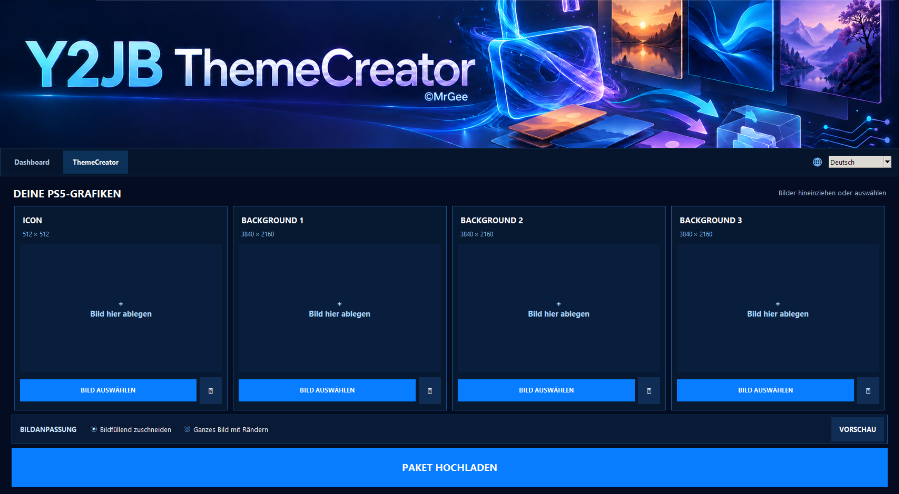
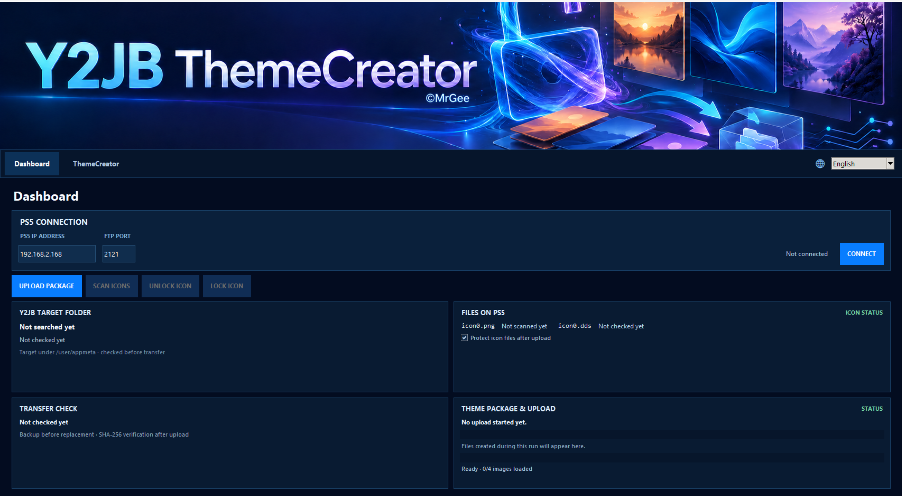
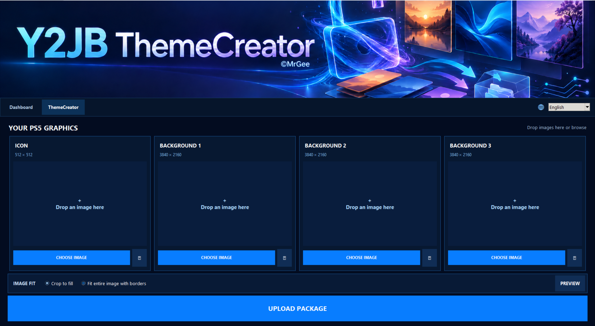

# 🎨 Y2JB Theme Creator v2.0

**🌐 Unterstützte App-Sprachen / Supported app languages:** 🇩🇪 Deutsch · 🇬🇧 Englisch · 🇪🇸 Spanisch · 🇫🇷 Französisch · 🇵🇹 Portugiesisch · [🇬🇧 English version](#-english)

> **⚠️ Voraussetzung / Requirement:** Für den FTP-Upload muss der [ftpsrv](https://github.com/ps5-payload-dev/ftpsrv)-Payload auf einer kompatiblen PS5 installiert und gestartet sein (Standardport `2121`). The [ftpsrv](https://github.com/ps5-payload-dev/ftpsrv) payload must be installed and running on a compatible PS5 for FTP uploads (default port `2121`).

**Kostenlose Windows-Freeware · Proprietär · Closed Source**

[⬇️ Windows-Installer herunterladen](https://github.com/mrguddi84-bit/Y2JB-MrGee-Theme-Builder-Pro/releases/download/v2.0/Y2JBThemeCreator_v2.0_Setup.exe) · [Alle Release-Details](https://github.com/mrguddi84-bit/Y2JB-MrGee-Theme-Builder-Pro/releases/latest) · [Änderungsprotokoll](CHANGELOG.md)

Version 2.0 ist die aktuelle Ausgabe von Y2JB Theme Creator. Erstelle **Y2JB-Themes** aus eigenen PNG-Grafiken und übertrage die dafür benötigten Dateien über FTP auf eine kompatible PS5 mit laufendem `ftpsrv`-Payload. Das Programm wird kostenlos als proprietäre Software angeboten; der Python-Quellcode von Version 2.0 wird nicht veröffentlicht.

## 🇩🇪 Deutsch

### ✨ Funktionen

- Kompaktes **Theme Studio** zum Vorbereiten von Icon und Hintergrund
- Erstellung der für Y2JB benötigten Theme-Dateien aus PNG-Grafiken
- FTP-Upload auf eine kompatible PS5 mit laufendem `ftpsrv`
- Rückfrage, bevor vorhandene Dateien überschrieben werden
- Statusanzeige für Paketerstellung und Upload im Dashboard
- Verbindung zur PS5 mit IP-Adresse und FTP-Port; Einstellungen lokal und pro Windows-Benutzer mit DPAPI geschützt
- Vereinfachte Ordnerstruktur mit `EINGABE` und `PS5_Upload`
- Windows-Installer mit auswählbarem Installationsverzeichnis
- Bedienoberfläche auf Deutsch, Englisch, Spanisch, Französisch und Portugiesisch

### 🖥️ Screenshots – Deutsch

**Dashboard**

**ThemeCreator**

### 📐 PNG-Dateien

Lege die Grafiken im Ordner `EINGABE` ab:

| Grafik | Größe | Dateiname |
|---|---:|---|
| Icon | 512 × 512 px | `icon0.png` |
| Hintergrund | 3840 × 2160 px | `pic0.png`, `pic1.png`, `pic2.png` |

Das Hintergrundmotiv muss unter allen drei Dateinamen vorhanden sein.

### 🚀 Installation und Verwendung

1. Lade `Y2JBThemeCreator_v2.0_Setup.exe` über den [v2.0-Release](https://github.com/mrguddi84-bit/Y2JB-MrGee-Theme-Builder-Pro/releases/latest) herunter und starte den Installer.
2. Wähle den Installationsordner und schließe die Installation ab.
3. Bereite deine PNG-Dateien im Ordner `EINGABE` vor und öffne den Theme Creator.
4. Stelle sicher, dass der `ftpsrv`-Payload auf der kompatiblen PS5 läuft (üblicher Port: `2121`).
5. Trage im Dashboard die PS5-IP-Adresse und den FTP-Port ein und verbinde dich.
6. Erstelle das Y2JB-Theme-Paket. Der Status wird im Dashboard angezeigt; bestätige die Rückfrage, falls Dateien auf der PS5 überschrieben werden sollen.

**Sicherheit:** FTP überträgt Daten unverschlüsselt. Verwende den Upload nur in einem vertrauenswürdigen lokalen Netzwerk und veröffentliche den FTP-Dienst nicht im Internet. Änderungen an der Konsole erfolgen auf eigene Verantwortung.

### 🔒 Lizenz und Hinweise

Y2JB Theme Creator v2.0 ist kostenlose, proprietäre Software. Der v2.0-Python-Quellcode wird nicht öffentlich bereitgestellt. © 2026 MrGee. Alle Rechte vorbehalten. Drittanbieterkomponenten behalten ihre eigenen Lizenzen und Hinweise; siehe [LICENSE](LICENSE), [THIRD_PARTY_LICENSES.md](THIRD_PARTY_LICENSES.md), [CREDITS.md](CREDITS.md) und den Ordner [`licenses`](licenses/).

Dieses unabhängige Projekt ist **inoffiziell** und steht nicht in Verbindung mit Sony Interactive Entertainment. Marken Dritter gehören ihren jeweiligen Inhabern.

---

## 🇬🇧 English

Y2JB Theme Creator v2.0 is the current release. Create **Y2JB theme files** from custom PNG artwork and transfer them over FTP to a compatible PS5 running the `ftpsrv` payload. The application is free to use and proprietary; v2.0 Python source code is not publicly distributed.

### ✨ Features

- Compact **Theme Studio** for preparing icon and background artwork
- Create the theme files required by Y2JB from PNG artwork
- FTP upload to a compatible PS5 running `ftpsrv`
- Confirmation before overwriting existing files
- Dashboard status for package creation and upload
- PS5 connection by IP address and FTP port; settings are stored locally and protected per Windows user with DPAPI
- Simplified folder layout with `EINGABE` and `PS5_Upload`
- Windows installer with a selectable installation directory
- User interface available in German, English, Spanish, French, and Portuguese

### 🖥️ Screenshots – English

**Dashboard**

**ThemeCreator**

### 📐 PNG requirements

Place your artwork in the `EINGABE` folder:

| Image | Dimensions | Filename |
|---|---:|---|
| Icon | 512 × 512 px | `icon0.png` |
| Background | 3840 × 2160 px | `pic0.png`, `pic1.png`, `pic2.png` |

The background artwork must be present under all three filenames.

### 🚀 Installation and usage

1. Download and run `Y2JBThemeCreator_v2.0_Setup.exe` from the [v2.0 release](https://github.com/mrguddi84-bit/Y2JB-MrGee-Theme-Builder-Pro/releases/latest).
2. Choose an installation directory and complete setup.
3. Prepare your PNG files in `EINGABE` and open Theme Creator.
4. Make sure the `ftpsrv` payload is running on your compatible PS5 (usual port: `2121`).
5. Enter the PS5 IP address and FTP port in the Dashboard and connect.
6. Create the Y2JB theme package. The Dashboard shows progress; confirm if existing files on the PS5 should be replaced.

**Security:** FTP traffic is not encrypted. Use uploads only on a trusted local network and do not expose the FTP service to the internet. You are responsible for changes to your console.

### 🔒 License and notices

Y2JB Theme Creator v2.0 is free proprietary software. v2.0 Python source code is not publicly distributed. © 2026 MrGee. All rights reserved. Third-party components retain their own licenses and notices; see [LICENSE](LICENSE), [THIRD_PARTY_LICENSES.md](THIRD_PARTY_LICENSES.md), [CREDITS.md](CREDITS.md), and the [`licenses`](licenses/) folder.

This independent project is **unofficial** and is not affiliated with Sony Interactive Entertainment. Third-party trademarks are the property of their respective owners.
