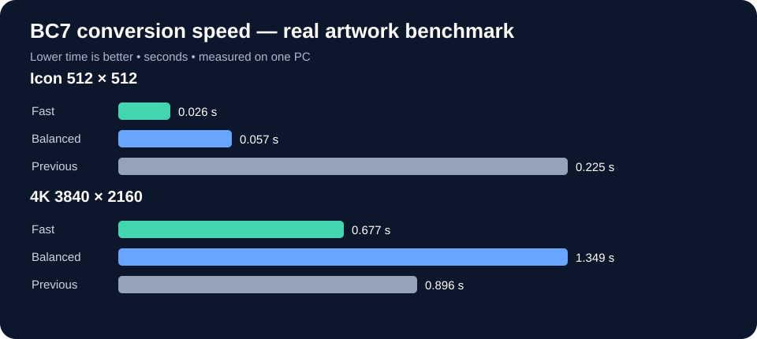
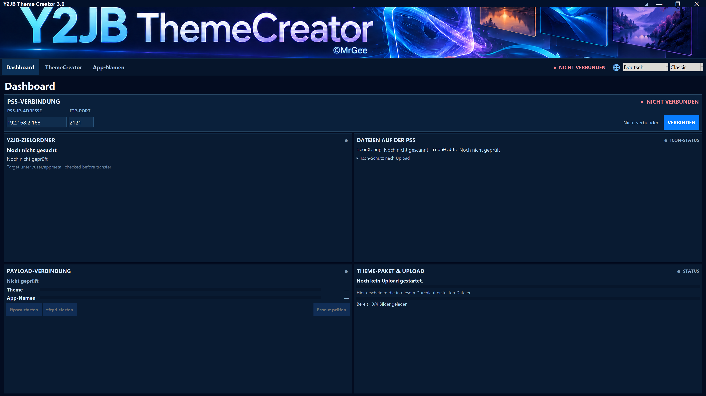
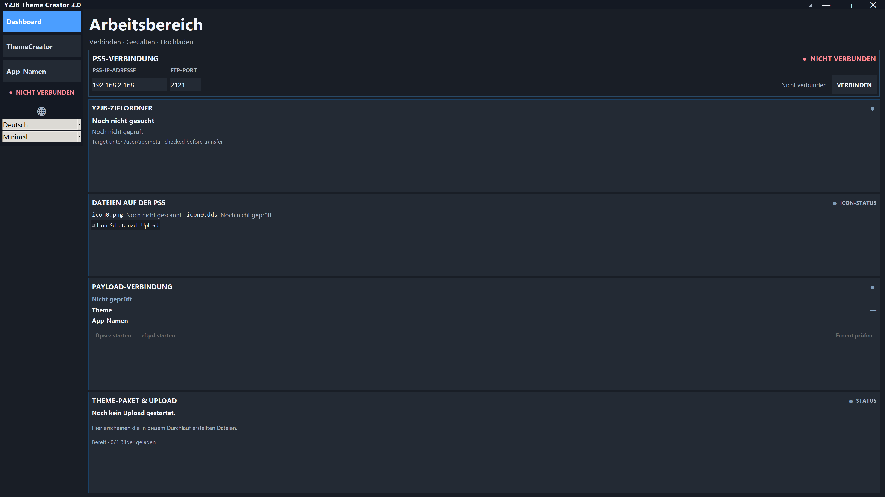
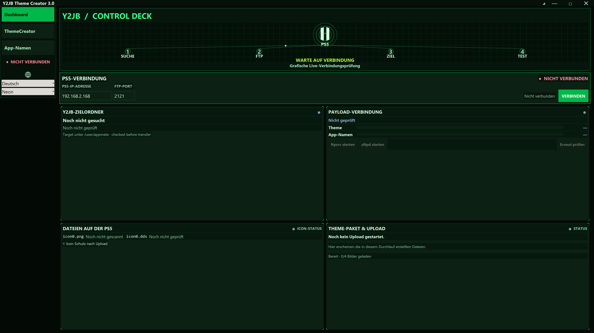

# 🎮 Y2JB Theme Creator 3.0

**Create · Customize · Upload**

   

**Developed by MrGee with AI assistance**

[🇩🇪 Deutsch](README.de.md) · **🇬🇧 English** · [🇪🇸 Español](README.es.md) · [🇫🇷 Français](README.fr.md) · [🇵🇹 Português](README.pt.md)

[**Download / Releases**](https://github.com/mrguddi84-bit/Y2JB-MrGee-Theme-Builder-Pro/releases) · [**Changelog**](https://github.com/mrguddi84-bit/Y2JB-MrGee-Theme-Builder-Pro/blob/main/CHANGELOG.md) · [**Credits**](https://github.com/mrguddi84-bit/Y2JB-MrGee-Theme-Builder-Pro/blob/main/CREDITS.md)

---

## ✨ Create your own Y2JB themes

Convert your own PNG artwork into Y2JB theme files, customize icons and 4K backgrounds, and upload them to a compatible PS5. Y2JB Theme Creator is an independent Windows homebrew utility.

[Features](#features) · [Quick start](#quick-start) · [Image specifications](#image-specifications) · [FTP payloads and requirements](#ftp-payloads) · [BC7 performance — measured results](#bc7-benchmarks) · [Interface themes](#screenshots) · [Safety notes](#safety) · [Credits and disclaimer](#credits)

## 🚀 Features

| | |
|---|---|
| 🎨 | Convert custom PNG graphics into Y2JB theme files |
| 🖼️ | 4K backgrounds (3840 × 2160) and 512 × 512 icons |
| ⚡ | Native parallel BC7 DDS encoding with Fast and Balanced profiles |
| 📡 | FTP management: bundled zftpd and official ftpsrv launch |
| 🔍 | FTP diagnostics, target detection and upload progress |
| 🛡️ | Backups, restore workflows and SHA-256 upload verification |
| ✏️ | Edit Y2JB app names with database backup and restore |
| 🎭 | Classic, Minimal and Neon interface themes |
| 🌍 | German, English, Spanish, French and Portuguese |

## 🛠️ Quick start

1. Download the portable Windows release, extract it and launch `Y2JBThemeCreator.exe`.
2. Enter your PS5 IP address. Launch bundled zftpd via a reachable elfldr service, or start official ftpsrv through the app. An already running FTP server is also supported.
3. Select PNG images from **any folder on your computer** in Theme Creator.
4. Create the Y2JB theme files and optionally upload them via FTP.

## 🖼️ Image specifications

| File | Purpose | Resolution |
|---|---|---|
| `icon0.png` | Theme icon | 512 × 512 |
| `pic0.png` | Background 1 | 3840 × 2160 |
| `pic1.png` | Background 2 | 3840 × 2160 |
| `pic2.png` | Background 3 | 3840 × 2160 |

The application resizes artwork to the required output dimensions. One image may be reused for multiple backgrounds.

## 📡 FTP payloads and requirements

**zftpd v1.7.0 is bundled** with the application. The app can start it through an accessible elfldr service. **ftpsrv is not bundled:** using the built-in ftpsrv action, the **PS5 fetches the official ELF directly from the ftpsrv GitHub release** and starts it through elfldr. This requires PS5 internet access. Alternatively, start ftpsrv via a compatible Payload Manager. The app then checks FTP availability.

- [Official ftpsrv repository](https://github.com/ps5-payload-dev/ftpsrv)
- [Official ftpsrv ELF release](https://github.com/ps5-payload-dev/ftpsrv/releases/latest/download/ftpsrv-ps5.elf)
- zftpd v1.7.0: bundled in the Windows build, with its third-party license.

## ⚡ BC7 performance — measured results

Real-artwork comparison on one test PC. Fast was about **8.7× faster for the icon** and **24% faster for the 4K background** than the previous encoder. Both test images also achieved higher PSNR. Results vary with CPU, artwork and settings.

### Icon — 512 × 512

| Encoder | Time | Quality (PSNR) |
|---|---:|---:|
| **Y2JB Fast** | **0.026** s | 35.43 dB |
| Y2JB Balanced | 0.057 s | **36.96** dB |
| Previous encoder | 0.225 s | 33.78 dB |

### Background — 3840 × 2160

| Encoder | Time | Quality (PSNR) |
|---|---:|---:|
| **Y2JB Fast** | **0.677** s | 45.73 dB |
| Y2JB Balanced | 1.349 s | **46.11** dB |
| Previous encoder | 0.896 s | 44.51 dB |

> Test results are specific to the measured images and hardware. PSNR is a metric, not a universal visual-quality guarantee.

## 🎭 Interface themes

| Classic | Minimal | Neon |
|---|---|---|
|  |  |  |

## ⚠️ Safety notes

FTP is unencrypted: use it only on a trusted local network. Editing PS5 databases is sensitive; keep backups and verify your target files. A compatible PS5 homebrew environment and elfldr are required for payload launching.

## ❤️ Credits and disclaimer

Developed by **MrGee with AI assistance**. Thanks to the contributors of zftpd, ftpsrv, ispc_texcomp, Pillow, TkinterDnD, Tk/Tcl, Python and Nuitka. Third-party software retains its own licenses. This is an independent homebrew project, not affiliated with or endorsed by Sony Interactive Entertainment.

See also: [CHANGELOG.md](CHANGELOG.md) · [CREDITS.md](CREDITS.md) · [THIRD_PARTY_LICENSES.md](THIRD_PARTY_LICENSES.md) · [LICENSE](LICENSE)
