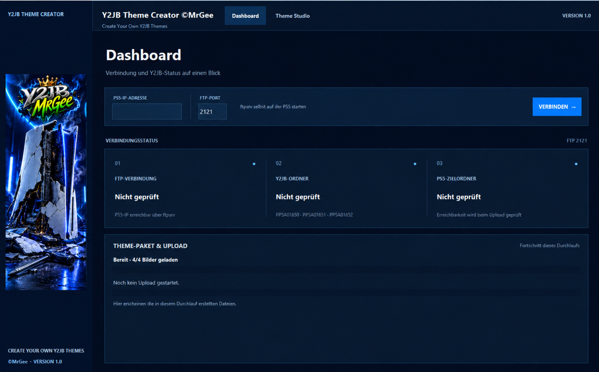
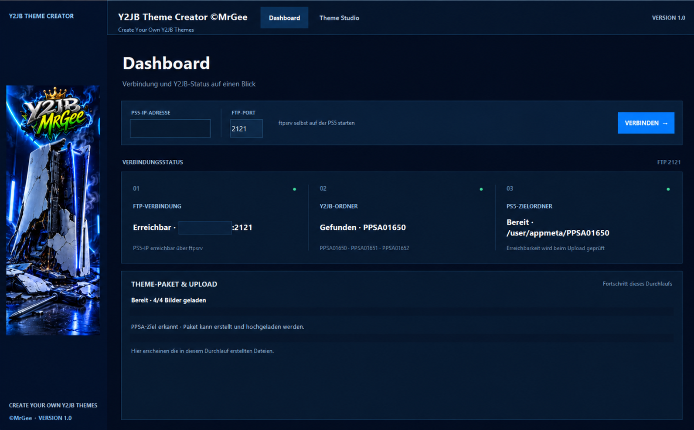
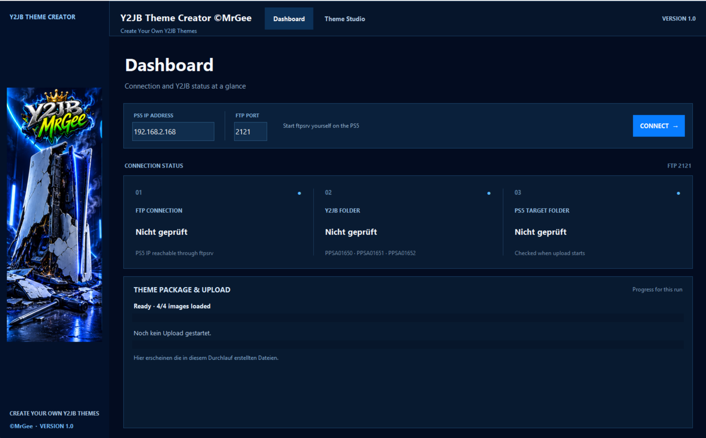

# Y2JB Theme Creator Pro by MrGee

**Deutsch** | [English](#english)

## Deutsch

**Y2JB Theme Creator Pro** ist eine Windows-Anwendung zum Erstellen und Übertragen von Theme-Dateien für **Y2JB auf der PS5**. Die App erstellt die von Y2JB benötigten Bilddateien, sucht automatisch das passende Y2JB-Verzeichnis auf der PS5 und lädt die Dateien anschließend automatisch per FTP hoch.

### Dashboard-Screenshots

**Vor der Verbindung (Deutsch):**

**Nach erfolgreicher Verbindung (Deutsch):**

### Funktionen
- Theme Studio zur Bearbeitung und Vorbereitung von Grafiken
- Bildkonvertierung für die benötigten Theme-Dateien
- Erstellung der für ein Y2JB-Theme benötigten Dateien
- Automatischer Scan von `/user/appmeta` nach den Y2JB-Ordnern `PPSA01650`, `PPSA01651` und `PPSA01652`
- Automatischer FTP-Upload nach erfolgreicher Paketerstellung; vorhandene Dateien werden nur nach Bestätigung überschrieben
- Windows-EXE zum direkten Starten

### PNG-Dateien und Ablage in `EINGABE`
Lege die folgenden PNG-Dateien im Ordner `EINGABE` der App ab:

| Bild | Größe | Dateiname | Anzahl |
|---|---:|---|---:|
| Icon | 512 × 512 px | `icon0.png` | 1 |
| Background | 3840 × 2160 px | `pic0.png`, `pic1.png`, `pic2.png` | 3 |

Das Background-Bild muss also unter allen drei Dateinamen in `EINGABE` vorhanden sein. Wenn du dasselbe Motiv für alle drei Hintergründe möchtest, kannst du die Datei dreimal kopieren und entsprechend benennen.

### Voraussetzung: ftpsrv-Payload auf der PS5
Für den automatischen FTP-Transfer muss auf der PS5 der **ftpsrv-Payload installiert und gestartet** sein. Installiere bzw. verwalte ihn im **Payload Manager** unter **Payload Verwaltung**. Der Payload stellt den FTP-Server auf der PS5 bereit; der Standardport ist **2121**. Er setzt eine kompatible Payload-Umgebung auf der PS5 voraus. Weitere Informationen: [ps5-payload-dev/ftpsrv](https://github.com/ps5-payload-dev/ftpsrv).

### Installation und Verwendung
1. Lade das Windows-Paket aus den **Releases** herunter und entpacke es in einen beschreibbaren Ordner.
2. Starte `Y2JBThemeCreator.exe`.
3. Installiere und starte `ftpsrv` auf der PS5 über den Payload Manager unter **Payload Verwaltung**.
4. Verbinde PC und PS5 mit demselben vertrauenswürdigen lokalen Netzwerk und trage in der App die IP-Adresse der PS5 sowie den FTP-Port ein (Standard: `2121`).
5. Wähle die Grafiken im Theme Studio aus und erstelle das Y2JB-Theme-Paket. Der Creator durchsucht `/user/appmeta` automatisch nach den Y2JB-Ordnern `PPSA01650`, `PPSA01651` und `PPSA01652` und startet danach den FTP-Upload automatisch. Bestätige die Abfrage, falls Dateien überschrieben werden sollen.

**Sicherheit:** FTP ist unverschlüsselt. Nutze den Upload nur in einem vertrauenswürdigen lokalen Netzwerk und veröffentliche den FTP-Dienst nicht im Internet. Änderungen an Zieldateien erfolgen auf eigene Verantwortung und nur auf Systemen, zu deren Änderung du berechtigt bist.

### Rechte und Hinweise
© 2026 MrGee. Alle Rechte vorbehalten. Der eigene Anwendungscode und die originalen Y2JB-Grafiken sind **proprietär**. Die öffentliche Bereitstellung des Quellcodes ist keine Open-Source-Lizenz. Details in [LICENSE](LICENSE). Drittanbieterkomponenten haben eigene Lizenzen und Herkunftshinweise; siehe [THIRD_PARTY_LICENSES.md](THIRD_PARTY_LICENSES.md) und [CREDITS.md](CREDITS.md).

Dieses Projekt ist **inoffiziell** und weder mit Sony Interactive Entertainment verbunden noch von Sony unterstützt. Das Y2JB-Logo stammt vom Projektinhaber; die mitgelieferten Beispielgrafiken wurden nach dessen Angaben mit ChatGPT erzeugt. Marken Dritter gehören ihren jeweiligen Inhabern.

**Build-Hinweis:** Die vorhandene Windows-EXE wurde für die GitHub-Veröffentlichung nicht verändert oder neu gebaut. Ihre gespeicherte Standard-IP kann von der des veröffentlichten Python-Codes abweichen; eine vollständig reproduzierbare Build-Konfiguration ist nicht enthalten.

---

## English

**Y2JB Theme Creator Pro** is a Windows app for preparing and transferring theme files for **Y2JB on PS5**. It creates the image files used by Y2JB, automatically finds the correct Y2JB directory on the PS5, and uploads the files over FTP.

### Dashboard screenshots

**Before connecting (English):**

### Features
- Theme Studio for preparing and editing graphics
- Image conversion for the required theme assets
- Create theme files for Y2JB
- Automatic scan of `/user/appmeta` for Y2JB folders `PPSA01650`, `PPSA01651`, and `PPSA01652`
- Automatic FTP upload after package creation; existing files are overwritten only after confirmation
- Ready-to-run Windows executable

### PNG files and the `EINGABE` folder
Place these PNG files in the app's `EINGABE` folder:

| Image | Dimensions | Filename | Count |
|---|---:|---|---:|
| Icon | 512 × 512 px | `icon0.png` | 1 |
| Background | 3840 × 2160 px | `pic0.png`, `pic1.png`, `pic2.png` | 3 |

The background image must therefore be present in `EINGABE` under all three filenames. If you want the same artwork for all three backgrounds, copy the image three times and name each copy accordingly.

### Requirement: ftpsrv payload on the PS5
For automatic FTP transfer, the **ftpsrv payload must be installed and running on the PS5**. Install or manage it in **Payload Manager** under **Payload Verwaltung** (Payload Management). The payload provides the FTP server on the PS5 and uses port **2121** by default. A compatible payload environment is required. See [ps5-payload-dev/ftpsrv](https://github.com/ps5-payload-dev/ftpsrv) for details.

### Installation and usage
1. Download the Windows package from **Releases** and extract it into a writable folder.
2. Launch `Y2JBThemeCreator.exe`.
3. Install and start `ftpsrv` on the PS5 through Payload Manager under **Payload Verwaltung** (Payload Management).
4. Connect the PC and PS5 to the same trusted local network, then enter the PS5 IP address and FTP port in the app (default: `2121`).
5. Select your images in Theme Studio and create the Y2JB theme package. Theme Creator automatically scans `/user/appmeta` for Y2JB folders `PPSA01650`, `PPSA01651`, and `PPSA01652`, then starts the FTP upload. Confirm if existing files need to be overwritten.

**Security:** FTP is unencrypted. Use uploads only on a trusted local network; do not expose the FTP service to the internet. Only modify systems and files you are authorized to manage.

### Rights and notices
© 2026 MrGee. All rights reserved. The original application source and Y2JB artwork are **proprietary**. Public source availability does not grant an open-source license. See [LICENSE](LICENSE). Third-party components retain their own licenses and attribution; see [THIRD_PARTY_LICENSES.md](THIRD_PARTY_LICENSES.md) and [CREDITS.md](CREDITS.md).

This is an **unofficial** project and is not affiliated with or endorsed by Sony Interactive Entertainment. The Y2JB logo belongs to the project owner; the included sample images were reportedly generated using ChatGPT. Third-party trademarks remain the property of their respective owners.

**Build note:** The existing Windows executable was not modified or rebuilt for GitHub publication. Its saved default IP may differ from the published Python source; a fully reproducible build configuration is not provided.

---

## Beispiel-Theme (Deutsch)

**Bild 1 ist das Icon, Bild 2 der Hintergrund.** Für die Dateien im Ordner `EINGABE` gelten weiterhin die oben genannten PNG-Größen.

**Icon (Bild 1):**

**Hintergrund (Bild 2):**

## Example theme (English)

**Image 1 is the icon; image 2 is the background.** The PNG dimensions listed above still apply to files in the app's `EINGABE` folder.

**Icon (image 1):**

**Background (image 2):**

